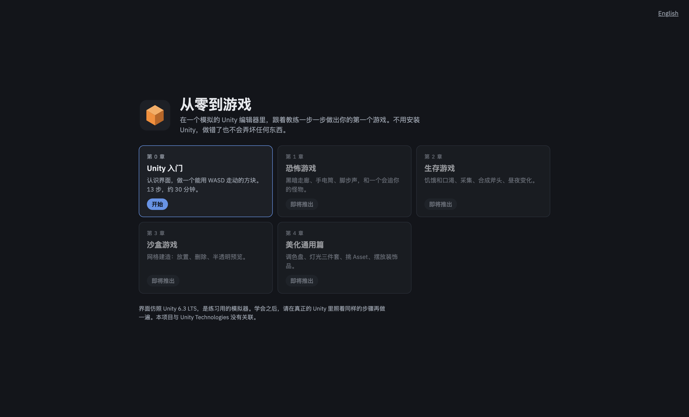
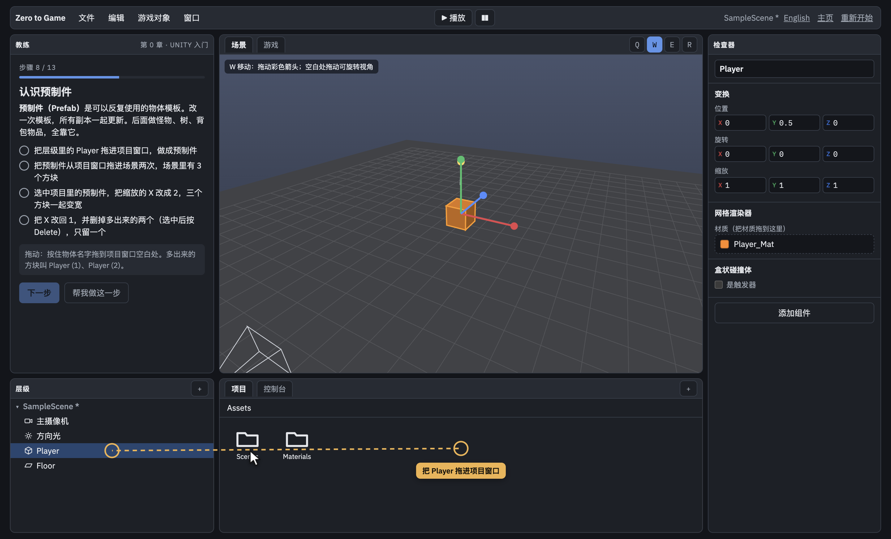

# 从零到游戏 Zero to Game

在一个模拟的游戏编辑器里（界面仿照 Unity），跟着教练一步一步学做游戏。给完全没做过游戏的新手。

不用先装 Unity，也不会把项目弄坏。打开 app，选一章，界面左边的教练会告诉你下一步点哪里、拖什么、改哪个数字。做对了，清单会自动打勾。





## 下载和运行

### 方法一：下载安装包（推荐给普通玩家）

到本仓库右边的 **Releases**，下载对应系统的文件：

| 系统 | 下载哪个 |
| --- | --- |
| Windows | `Zero to Game Setup x.x.x.exe`（安装版），或 `Zero to Game x.x.x.exe`（免安装，双击直接开） |
| macOS | `Zero to Game-x.x.x.dmg` |
| Linux | `Zero to Game-x.x.x.AppImage` |

Windows 第一次打开时，如果出现「Windows 已保护你的电脑」，点「更多信息」，再点「仍要运行」。这是因为安装包没有付费签名，不是病毒。macOS 同理：右键点 app，选「打开」。

### 方法二：从源码运行（给想改内容的人）

先安装 [Node.js](https://nodejs.org)（选 LTS 版本），然后在这个文件夹里打开终端：

```bash
npm install     # 第一次运行，下载依赖
npm start       # 打开 app
```

自己打包安装包：

```bash
npm run dist:win     # Windows，产出在 dist 文件夹
npm run dist:mac     # macOS（需要在 Mac 上运行）
npm run dist:linux   # Linux
```

## 现在有什么

**第 0 章：Unity 入门**，共 13 步，约 30 分钟。界面有中文和英文两种，主页右上角可以切换。教练会用发亮的边框、箭头和拖动动画告诉你下一步点哪里、拖什么。

1. 认识五个窗口：Hierarchy、Scene、Game、Inspector、Project
2. 创建一个方块
3. 改名并放好位置
4. 移动、旋转、缩放（W、E、R）
5. 做地板
6. 新建 Material
7. 上色并拖到物体上
8. 认识 Prefab
9. 第一段 C# 脚本（可以点每一行看解释）
10. 调整摄像机
11. 点 Play，用 WASD 走动
12. 加 Rigidbody（刚体），走出地板会掉下去
13. 保存场景

模拟器也会重现新手常犯的错：脚本名字和 class 不一致会在 Console 报红字；Play 模式下的修改停止后会还原；没加 Rigidbody 的方块走出地板会浮在空中；没保存的场景名字后面有 `*`。

## 路线图

- [x] 第 0 章：Unity 入门
- [ ] 第 1 章：恐怖游戏（手电筒、脚步声、追逐 AI、后期处理）
- [ ] 第 2 章：生存游戏（数值、采集、合成、昼夜）
- [ ] 第 3 章：沙盒游戏（网格建造）
- [ ] 第 4 章：美化通用篇（调色盘、灯光、Asset、装饰品摆放）

## 项目结构

```
app/index.html          页面结构
app/styles.css          样式
app/i18n.js             界面文字（中文 / English）
app/chapters/ch0.js     第 0 章的教练步骤
app/editor.js           虚拟编辑器：3D 视图、拖放、物理、教练提示
main.js                 桌面 app 入口（Electron）
build/icon.png          app 图标
scripts/smoke.js        冒烟测试：打开 app 截图，npm run smoke
.github/workflows/      推送 v 开头的 tag 时自动打包三个系统的安装包
docs/                   截图
```

### 怎么加一章或改步骤

步骤写在 `app/chapters/ch0.js` 里的 `STEPS` 数组。文字都写成 `{zh: '中文', en: 'English'}`。每一步有：

- `title`：标题
- `body`：说明文字
- `conds`：打勾清单，每项是「文字 + 检查函数」，函数返回 true 就自动打勾
- `hint`：提示
- `auto`：「帮我做这一步」按钮要做的事
- `glow`：要发亮提示的界面区域
- `point`：箭头指向哪里，或者演示从哪里拖到哪里

界面上的文字（按钮、菜单、窗口名字）在 `app/i18n.js`。

## 发布新版本

```bash
git tag v0.1.0
git push origin v0.1.0
```

GitHub Actions 会自动在 Windows、macOS、Linux 上打包，并把安装包放到 Releases。

## 说明

界面仿照 Unity 6.3 LTS，是练习用的模拟器，不是真正的游戏引擎。学会之后，请在官方 Unity 里照着同样的步骤再做一遍。本项目与 Unity Technologies 没有关联，Unity 是 Unity Technologies 的商标。

## 授权

MIT
